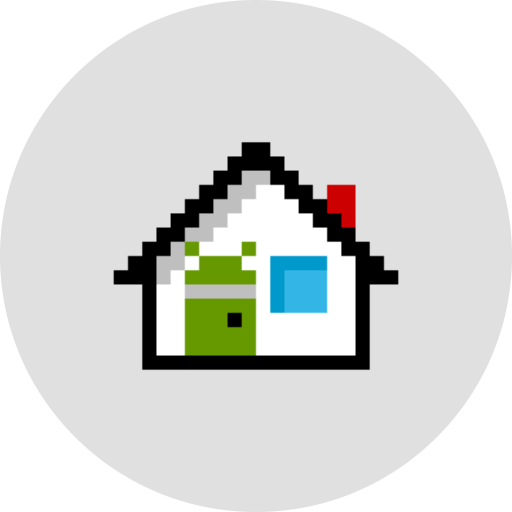

# Launcher3TV



A lightweight Home screen for Android TV that looks and moves like Google TV's Apps screen, without the ads.

It started as a replacement for the stock Google TV launcher on a 2 GB Skyworth TV. Layout, colours and timings were measured from Google TV itself. That meant screenshots, layout dumps and frame-by-frame screen recordings, not guesswork.

## What's on the screen

- **Top bar**: account button, Search and Apps, screensaver, AMOLED on/off, Settings, clock.
- **Your apps**: your installed TV apps as round tiles. Long-press one for Open, Move or App info. The order is saved.
- **Search for apps and games**: opens Play Store search.
- **Continue watching**: the system's Watch Next list (the same one Google TV reads). Cards show progress and a Resume or Watch label.
- **Your TV**: the TV's inputs (Live TV, HDMI 1–3, with whatever is connected over HDMI-CEC) beside six settings tiles. Picture, Sound, Wi-Fi, Bluetooth, Apps and Settings each show their current reading.

Only the focused row shows its title, and it grows in as the row takes focus.

## Light on the TV

- Plain Android Views with the leanback grid, no Compose and no image library. The APK is under 500 KB.
- About 45–55 MB of memory on Home. Posters are decoded at display size, cached on disk, and released while another app is on screen.
- Focus and press use Material 3 springs. Scrolling uses the platform's own smooth scroller.

## Requirements

Android TV 11 (API 30) or later.

## Build

```sh
cd launcher
./gradlew assembleRelease
```

The release build is signed with your local debug key, which is fine for sideloading. Use JDK 17 or newer (Android Studio's bundled JDK works).

## Install

```sh
adb install -r launcher/app/build/outputs/apk/release/app-release.apk
# Lets Continue watching read the system Watch Next list:
adb shell pm grant dev.home.tvlauncher android.permission.READ_TV_LISTINGS
```

Or download the APK from [Releases](../../releases).

### Making it the Home app

Google TV builds give their own launcher priority for the Home button, ahead of any app you choose. To make the Home button open Launcher3TV, switch off Google TV's launcher and its setup app. This disables them; it doesn't uninstall them:

```sh
adb shell pm disable-user --user 0 com.google.android.apps.tv.launcherx
adb shell pm disable-user --user 0 com.google.android.tungsten.setupwraith
adb shell cmd package set-home-activity dev.home.tvlauncher/.MainActivity
```

While they're off, Google TV's quick settings panel and profile switcher aren't available. To undo it:

```sh
adb shell pm enable --user 0 com.google.android.apps.tv.launcherx
adb shell pm enable --user 0 com.google.android.tungsten.setupwraith
```

## Icon

`assets-src/icon-reference.png` is the source artwork. `tools/make_icon.py` turns each of its pixels into a vector square for the app icon and the TV banner:

```sh
python3 tools/make_icon.py launcher/app/src/main/res/drawable
```

## Credits

The font is a trimmed copy of Google Sans Flex, used under the SIL Open Font License 1.1 (`launcher/app/src/main/assets/licenses/OFL.txt`). It's renamed inside the app, as the licence asks for modified versions.
