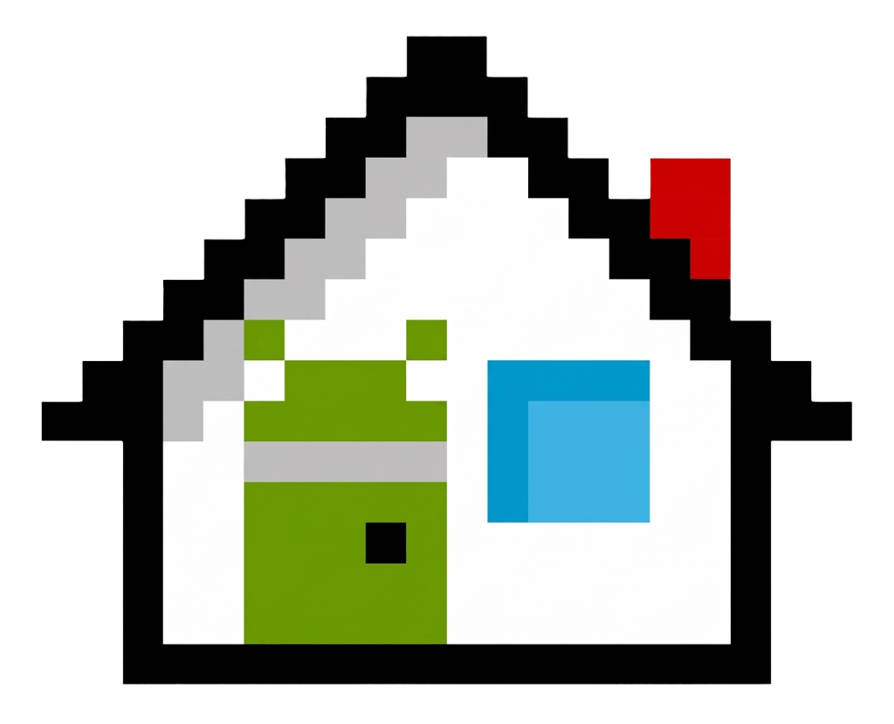

### Launcher3TV

A straightforward, ad-free replacement for the Google TV launcher. Gives you a clean, stock-like Android TV home screen focused on your apps, Continue Watching, and TV inputs, with zero sponsored content, recommendations, or background bloat.

## Features

- **Your apps**: Installed TV apps as clean tiles. Long-press any app to open, move/reorder, or view app info. The app order is saved.
- **Continue watching**: Connects directly to the system Watch Next database (the same one Google TV reads). Shows thumbnails, progress bar, and resume action.
- **Your TV**: Quick switching between inputs (Live TV, HDMI 1-3, with names detected over HDMI-CEC) alongside six settings tiles showing live status (Picture, Sound, Wi-Fi, Bluetooth, Storage, and Settings).
- **Top bar**: Play Store search, screensaver shortcut, AMOLED black theme toggle, Settings shortcut, and clock.
- **Zero ads**: No suggested shows, autoplay trailers, or promoted rows. Only the focused row expands its title.

## Performance

- **Tiny footprint**: Plain Android Views and Leanback grid without Compose or heavy image loading libraries. The APK is under 500 KB.
- **Low memory**: Runs in ~45-55 MB of RAM. Media posters are decoded to exact display size, cached on disk, and freed from memory when you switch to another app.
- **Responsive navigation**: Focus and press animations use Material 3 springs; scrolling uses Android's native smooth scroller.

## Requirements

Android TV 11 (API 30) or later.

## Install

Download the APK from **[Releases](../../releases)**.

Install over ADB:

```sh
adb install -r Launcher3TV.apk
# Allow Continue Watching to read the system Watch Next database:
adb shell pm grant dev.home.tvlauncher android.permission.READ_TV_LISTINGS
```

### Making it the Home app

Google TV gives its stock launcher priority for the remote's Home button. To make Launcher3TV handle Home presses, disable the stock launcher and setup wizard:

```sh
adb shell pm disable-user --user 0 com.google.android.apps.tv.launcherx
adb shell pm disable-user --user 0 com.google.android.tungsten.setupwraith
adb shell cmd package set-home-activity dev.home.tvlauncher/.MainActivity
```

*(Note: While disabled, Google TV's quick settings side panel and profile switcher won't appear.)*

To restore the stock Google TV launcher:

```sh
adb shell pm enable --user 0 com.google.android.apps.tv.launcherx
adb shell pm enable --user 0 com.google.android.tungsten.setupwraith
```

## Build

Requires JDK 17+ and the Android SDK.

```sh
cd launcher
./gradlew assembleRelease
```

The APK is signed with your local debug key, suitable for sideloading. Output is at `launcher/app/build/outputs/apk/release/app-release.apk`.

## Icon

`assets-src/icon-reference.png` is the source artwork. `tools/make_icon.py` converts each pixel into vector squares for the launcher icon and TV banner:

```sh
python3 tools/make_icon.py launcher/app/src/main/res/drawable
```

## Credits

Font is a trimmed copy of Google Sans Flex under the SIL Open Font License 1.1 (`launcher/app/src/main/assets/licenses/OFL.txt`), renamed for inclusion.
